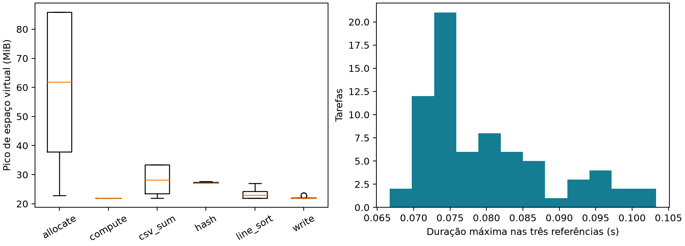

# INF0336 - Seminário

## Título do Seminário
Sentinela ML: recomendação supervisionada de recursos e capacidades para execução isolada de código de agentes

## Equipe

| Matrícula | Nome completo |
|---|---|
| 202401832 | Wender Viana Faria Santos |
| 202405859 | William Félix Ferreira Alves da Silva |
| 202405860 | Wryel Teodoro de Morais |
| 202401799 | Lourenço Tabosa Paniago |

## Apresentações
Os materiais de apresentação e seus roteiros são mantidos localmente, separados dos arquivos versionados. A estrutura acadêmica segue o modelo INF0336 em `docs/references/INF0336-modelo.md`.

## Resumo
Agentes capazes de executar código precisam de ambientes com recursos e acessos delimitados. O projeto mede um modelo supervisionado que recomenda limites e capacidades de leitura/escrita; uma política independente restringe cada recomendação à autorização externa. Os dados são workloads Python autorais, executados em sandbox Linux, com famílias separadas entre treino e avaliação.

O treino atual reúne 2.076 registros. No conjunto reservado independente usado no refinamento, o modelo híbrido concluiu 100/100 tarefas, contra 85/100 do modelo anterior, com cobertura conjunta de recursos de 100%. O orçamento médio de memória aumentou de 38,62 para 59,54 MiB. São resultados de benchmarks controlados, não uma afirmação de segurança em produção ou de economia equivalente de memória física.

## Introdução

### Motivação
Um agente que gera código pode executar operações incompatíveis com a tarefa: modificar entradas, tentar acessar rede ou ficar preso em execução. Um perfil amplo facilita a execução, mas expõe acessos desnecessários; um perfil rígido pode impedir tarefas legítimas. O projeto propõe estimar necessidades antes da execução, preservando um teto de autoridade independente da IA.

### Revisão bibliográfica
Saltzer e Schroeder [1] fundamentam menor privilégio e mediação de acessos. A arquitetura aplica esses princípios ao separar recomendação e autorização. Geurts, Ernst e Wehenkel [2] apresentam Extra Trees, família escolhida para regressão e classificação; sua publicação não prova que esse estimador supera heurísticas no problema estudado. Pedregosa et al. [3] descrevem a biblioteca usada para construir os modelos.

Bubblewrap [4] fornece mecanismos de montagem e isolamento utilizados pelo executor. As páginas getrlimit [5] e namespaces [6] esclarecem o alcance dos controles Linux, especialmente a diferença entre limitar espaço virtual por processo e controlar memória agregada. A documentação de boas práticas do scikit-learn [7] orienta a separação de dados e a exclusão de informações posteriores à execução das features. O modelo INF0336 [8] determina a organização deste relatório.

### Objetivos
Construir uma interface de execução que um agente possa chamar; medir demandas de recursos; treinar um regressor e um classificador multirrótulo; comparar com perfil fixo e heurística; testar contenção funcional e registrar limitações. O escopo não inclui um LLM gerador completo, GPU, RL ou execução pública de código hostil.

## Metodologia

### Dados e experimentos
O repositório contém um único conjunto de treino com 2.076 tarefas, 100 tarefas de validação e 24 do teste original. A comparação final também foi medida em 100 tarefas reservadas cujos registros brutos são locais. Cada tarefa recebe três execuções de referência. Tamanhos de entrada e sementes são determinísticos; não há coleta de usuários nem revisão humana independente. Capacidade significa ler a entrada e escrever a saída, não uma Linux capability de privilégio.

As famílias são mantidas inteiras em uma única partição para reduzir vazamento entre variantes parecidas. A validação escolhe as margens; conjuntos reservados medem generalização depois do congelamento. Os registros preservam hashes de código/entrada, medições e o instante real de observação.

### Modelos e infraestrutura
O executor usa Bubblewrap, mounts somente leitura para entradas, rede externa isolada e limites RLIMIT_AS, RLIMIT_CPU, RLIMIT_FSIZE e RLIMIT_NOFILE, além de timeout de parede. O modelo usa 14 features do tamanho da entrada e da AST, sem identificadores, famílias ou medidas posteriores à execução. O regressor híbrido usa Extra Trees para memória e Gradient Boosting para tempo; o classificador Extra Trees prediz leitura e escrita.

### Métricas e seleção
MAE de memória/tempo, F1 micro de capacidades, omissões e acessos excedentes. Sucesso exige retorno zero, ausência de timeout e igualdade de stdout e hashes das saídas. A validação escolhe margens em grade fixa, priorizando cobertura e menor orçamento. Um replay por método compara limites fixos de 128 MiB/2 s, uma heurística de tamanho/AST e o modelo supervisionado. A comparação mantém controles externos iguais e embaralha a ordem dos métodos por tarefa.

### Fluxograma

### Relação com Sistemas Operacionais
O trabalho integra isolamento de processos, mounts, namespaces de rede, endereçamento virtual, CPU, descritores, arquivos e ciclo de vida de processos. Nenhuma alteração no kernel é necessária.

### Desenvolvimento incremental
O protocolo separa recomendação estatística de autorização determinística. O treino reúne os workloads usados no modelo final; os candidatos anteriores aparecem apenas na comparação de métricas. A otimização CSV é uma operação distinta: `fused` reduz o trabalho por consulta, e ML só participa dessa seleção se superar a referência eficiente.

As capacidades são contratos autorais; não foram descobertas por avaliação causal de código arbitrário.

## Resultados

| Modelo | Treino | MAE memória (MiB) | MAE tempo (s) | Cobertura conjunta | Conclusões supervisionadas | Orçamento médio de memória |
|---|---:|---:|---:|---:|---:|---:|
| Padrão anterior | 96 | 5,979 | 0,0377 | 83% | 85/100 | 38,62 MiB |
| Candidato ampliado | 1.576 | 6,202 | 0,0558 | 90% | 90/100 | 46,74 MiB |
| Híbrido atual | 2.076 | 6,079 | 0,0229 | 100% | 100/100 | 59,54 MiB |

O híbrido concluiu 15 tarefas a mais que o modelo padrão anterior e elevou a cobertura conjunta, com aumento do orçamento médio de memória. Isso é uma troca entre cobertura e custo, não dominância em todas as métricas. O conjunto original de teste continua disponível como uma checagem complementar, menor e com famílias diferentes.

Na operação CSV, `auto` usa `fused` quando nenhum modelo passa o critério de promoção. O modelo de recursos de `run` permanece separado. Os nove ensaios funcionais de contenção passaram; a execução completa habilitada com namespaces passou em 45 testes. Esses resultados não equivalem a auditoria de segurança ou certificação.

## Discussão
O resultado sustenta a viabilidade de recomendar limites nos workloads avaliados. A melhora de conclusão veio acompanhada de orçamento médio maior, portanto não demonstra que o híbrido seja superior em qualquer métrica ou programa. O seletor CSV também mostra que uma implementação algorítmica eficiente pode resolver uma operação sem depender de ML. Intervalos de Wilson são apenas descritivos; variantes por família não são independentes.

A revisão de Saltzer e Schroeder [1] orienta a separação entre autoridade e previsão. O desempenho de Extra Trees [2] precisa ser julgado pelos experimentos, não pelo nome do algoritmo. A falha preservada do piloto confirma a importância de cobertura dos dados e de uma validação reservada para desenvolvimento [7]. Nenhuma decisão foi alterada após abrir o teste final.

Limitações: programas autorais simples, uma máquina, Python stdlib, três referências e apenas um replay por método, espera artificial de 40 ms e VmPeak amostrado. Não há tarefas reais geradas por agentes nem inferência de intenção em linguagem natural. A memória limitada é AS por processo. Faltam cgroups agregados, quota total de disco/tmpfs, limite de processos, seccomp específico e supervisor resistente a adulteração. O protótipo não está pronto para serviço público de execução hostil.

## Conclusão
O projeto entrega executor isolado, coleta rastreável, regressão e classificação supervisionadas e uma estratégia CSV de uma passagem. O refinamento ampliou os workloads e melhorou as conclusões no teste independente medido, com um orçamento de memória maior. A continuação recomendada é avaliar programas independentes e endurecer controles agregados antes de qualquer implantação.

## Referências

As referências fundamentam menor privilégio, isolamento Linux, Extra Trees e práticas de avaliação supervisionada. A aplicação e as limitações de cada fonte são resumidas abaixo.

1. SALTZER, Jerome H.; SCHROEDER, Michael D. The protection of information in computer systems. Proceedings of the IEEE, v. 63, n. 9, p. 1278-1308, 1975. DOI: 10.1109/PROC.1975.9939. Disponível em: <https://www.cs.virginia.edu/~evans/cs551/saltzer/>.
   **Uso:** menor privilégio, mediação e separação entre recomendação estatística e autorização determinística. O modelo não recebe autoridade para criar novos acessos.

2. GEURTS, Pierre; ERNST, Damien; WEHENKEL, Louis. Extremely randomized trees. Machine Learning, v. 63, p. 3-42, 2006. DOI: 10.1007/s10994-006-6226-1. Disponível em: <https://doi.org/10.1007/s10994-006-6226-1>.
   **Uso:** fundamentação do ensemble Extra Trees para regressão de recursos e classificação multirrótulo de capacidades. O artigo não comprova desempenho neste domínio.

3. PEDREGOSA, Fabian et al. Scikit-learn: machine learning in Python. Journal of Machine Learning Research, v. 12, n. 85, p. 2825-2830, 2011. Disponível em: <https://www.jmlr.org/papers/v12/pedregosa11a.html>.
   **Uso:** implementação dos estimadores supervisionados, métricas e reprodução com semente fixa.

4. CONTAINERS PROJECT. Bubblewrap: low-level unprivileged sandboxing tool. [S. l.]: Containers Project, [s. d.]. Disponível em: <https://github.com/containers/bubblewrap>.
   **Uso:** execução sem privilégios com namespaces, mounts seletivos e rede isolada. A segurança depende da configuração e do kernel; usar Bubblewrap não certifica a aplicação.

5. LINUX MAN-PAGES PROJECT. getrlimit(2): get/set resource limits. [S. l.]: Linux man-pages, [s. d.]. Disponível em: <https://www.man7.org/linux/man-pages/man2/getrlimit.2.html>.
   **Uso:** aplicação de RLIMIT_AS, RLIMIT_CPU, RLIMIT_FSIZE, RLIMIT_NOFILE e desativação de core dumps. AS limita espaço virtual por processo, não memória física agregada.

6. LINUX MAN-PAGES PROJECT. namespaces(7): overview of Linux namespaces. [S. l.]: Linux man-pages, [s. d.]. Disponível em: <https://www.man7.org/linux/man-pages/man7/namespaces.7.html>.
   **Uso:** separação de processos, mounts, rede e outros recursos. Namespace de cgroup não equivale à criação de limites de cgroup.

7. SCIKIT-LEARN DEVELOPERS. Common pitfalls and recommended practices. In: Scikit-learn 1.5.2 documentation. [S. l.], 2024. Disponível em: <https://scikit-learn.org/1.5/common_pitfalls.html>.
   **Uso:** impedir fit em validação/teste e excluir das features informações que só surgem depois da execução. O protocolo também separa famílias de programas.

8. 2026-2-INF0336-OPERATINGSYSTEMS. INF0336: Seminário: modelo de relatório. Repositório assets, 2026. Disponível em: <https://github.com/2026-2-INF0336-OperatingSystems/assets/blob/main/README.md>.
   **Uso:** estrutura dos relatórios incrementais: resumo de até dez orações, introdução, metodologia, fluxograma, resultados, discussão, conclusão e referências. Cópia local: references/INF0336-modelo.md. O repositório consultado não fornece tema gráfico de slides.

## Executar esta etapa

[Mapa dos componentes e materiais do projeto](docs/ENTREGAS.md).

[Instalação e demonstração](docs/EXECUCAO.md).

[Mapa técnico do código e dos comandos](docs/GUIA_TECNICO.md).

### Estratégias para CSV

| Opção | Uso |
|---|---|
| `auto` (padrão) | Política atual: usa `fused`, a menos que um modelo ML tenha sido promovido pela validação. |
| `fused` | Executa explicitamente a agregação em uma passagem, sem seleção por ML. |

Use `auto` no trabalho normal. `memory`, `blocks` e `heuristic` são mantidos apenas como baselines internos dos benchmarks, não como opções da CLI. O executável continua sendo `sentinela`.

### Modelo e comparação

O modelo ativo é híbrido: Extra Trees estima memória e capacidades; Gradient Boosting estima tempo. A comparação resumida entre o modelo anterior, o candidato intermediário e o modelo ativo está em [Métricas de comparação](docs/COMPARACAO_MODELOS.md). Só o modelo ativo e o dataset final são distribuídos.
