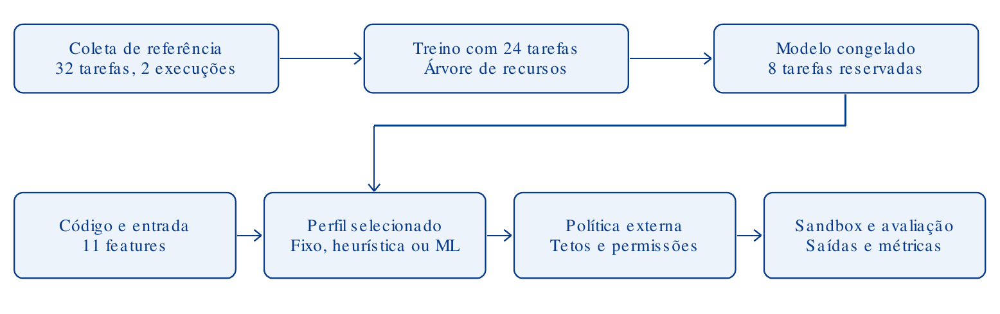

# Metodologia e protocolo experimental

## Pergunta e hipótese

Um recomendador supervisionado consegue reduzir os limites configurados e as
capacidades excedentes de uma sandbox sem reduzir as conclusões corretas em
relação a um perfil fixo e a uma heurística? Um limite menor não implica menor
uso físico de RAM nem execução mais rápida; essas grandezas são relatadas à
parte. O experimento mede workloads controlados, não pretende provar uma
superioridade universal do aprendizado de máquina.

## Escopo e isolamento

O sistema executa scripts Python/stdlib recebidos como arquivos. Não inclui um
agente gerador completo nem depende de API paga ou LLM. O usuário fornece a
entrada e o destino; o modelo não escolhe caminhos, rede ou novas permissões.

Bubblewrap monta o ambiente e as entradas com acesso somente para leitura,
isola a rede e cria os namespaces necessários. O processo recebe limites
RLIMIT_AS, RLIMIT_CPU, RLIMIT_FSIZE e RLIMIT_NOFILE, além de limite de tempo.
Sem suporte aos namespaces, a execução falha sem fallback no host. O protótipo
não implementa cgroups agregados de memória/processos, quota total de disco ou
tmpfs, nem política seccomp específica. O protocolo avalia workloads
controlados; não inclui ensaios de escape do kernel nem execuções multiusuário.

## Dados e partições

Os workloads são sintéticos, determinísticos e medidos em uma máquina Linux.
Famílias inteiras ficam em uma única partição para reduzir vazamento entre
variantes parecidas.

| Partição | Famílias | Amostras | Uso |
|---|---:|---:|---|
| Treino | 67 | 3.300 | Ajuste do modelo único |
| Validação | 5 | 100 | Escolha de margens e avaliação de desenvolvimento |
| Teste final | 17 | 850 | Avaliação final |

O teste corresponde a 20% dos 4.250 registros. Suas 17 famílias são distintas
das usadas no treino e na validação.

Cada tarefa tem três execuções de referência com limite de 256 MiB de espaço
virtual por processo, limite de tempo de 5 s e limite de CPU de 3 s. O alvo é
o maior VmPeak e a maior duração observados. VmPeak é amostrado em `/proc` e
pode perder picos muito curtos; RSS também é registrado, mas não é o alvo do
RLIMIT_AS. Uma espera artificial de 40 ms mantém os dados vivos para
amostragem e cria um piso temporal. Resultados de duração têm essa limitação.

Capacidades são rótulos do contrato de cada workload: ler `/input` e escrever
em `/output`.

## Features e modelo

O modelo usa 17 features anteriores à execução: tamanho da entrada e do código,
medidas da AST, laços, compreensões, chamadas, imports, operações de leitura e
escrita, ordenação, JSON, hash, alocação, maior literal numérico, maior número
estático de iterações de `range`, quantidade estimada de itens de compreensões
materializadas e bytes estimados de `bytearray`/`bytes`. Constantes numéricas
simples e expressões aritméticas seguras são avaliadas estaticamente. Essas
features descrevem o formato e o tamanho previsto do trabalho sem regras
associadas a nomes de família. Os campos de leitura/escrita reconhecem
`Path.read_text()` e `Path.open()` quando o caminho literal pertence a `/input`
ou `/output`. Identificador, família, split e medições posteriores à execução
não entram no estimador.

O único artefato ativo é um modelo híbrido:

- Extra Trees Regressor com 256 árvores, folhas mínimas de quatro amostras,
  semente 336 e um worker estima VmPeak.
- Gradient Boosting Regressor com 200 estágios, profundidade 2, taxa 0,03 e
  perda Huber estima tempo.
- Extra Trees Classifier com 128 árvores e folhas mínimas de duas amostras
  classifica leitura e escrita.

Os alvos de memória e tempo são transformados com `log1p` no fit. A inferência
multiplica as estimativas por margens de pelo menos 1,5 para memória e 2,0 para
tempo, acrescenta 4 MiB e 80 ms, respectivamente, e aplica pisos de 24 MiB e
200 ms. Dois envelopes aprendidos apenas no treino elevam o orçamento para
entradas e coleções estáticas grandes: o envelope de entrada usa o quantil 99%
de 715 exemplos de leitura com pelo menos 0,5 MiB e estima memória e tempo por
MiB de entrada; o de coleções usa o quantil 95% de 203 exemplos com pelo menos
1.000 itens materializados e estima memória por milhão de itens. Ambos têm base
de 24 MiB e teto de 128 MiB; o envelope de entrada também tem teto de 2 s.

A validação escolhe o menor orçamento médio normalizado à heurística entre os
candidatos com cobertura conjunta de 100%, quando essa cobertura é alcançável,
e então aplica as margens operacionais mínimas e os envelopes de treino. O
artefato congelado usa margens 1,5/2,0 e registra cobertura de 100/100 na
reexecução de validação.

A política de autorização intersecta a recomendação com o teto externo. O
modelo não pode elevar esse teto; recomendações não finitas, capacidades
desconhecidas e valores fora do contrato são rejeitados.

## Baselines e comparação

Perfil fixo: 128 MiB, 2 s e ambas as capacidades. Heurística: 32 MiB mais 64
vezes os MiB da entrada, limitado a 256 MiB; 1 s mais os MiB da entrada. Ela
usa as features AST de leitura/escrita, incluindo abertura literal de arquivos
em `/input` e `/output`. CPU, tamanho de saída e sandbox são iguais nos três
métodos.

Em cada rodada de comparação, cada tarefa recebe um replay por método, em ordem
determinística embaralhada pela semente da tarefa. Esse replay é distinto das
três referências usadas para criar os alvos. Sucesso operacional exige retorno
zero, ausência de timeout e igualdade de stdout e hashes das saídas. As rodadas
reutilizam o mesmo teste e o modelo congelado; os resultados são registrados
separadamente por rodada.

As métricas incluem MAE de memória/tempo, F1 micro e correspondência exata de
capacidades, capacidades omitidas/excedentes, conclusões por família, limites
médios configurados e duração observada. Intervalos de Wilson são apresentados
de forma descritiva; as variantes compartilham o mesmo tipo de workload. Os
detalhes e a interpretação da avaliação final estão em
[Métricas de comparação](COMPARACAO_MODELOS.md).

## Reprodução e escopo

Os JSONL registram hashes dos dados e o instante real de observação. Os vetores
de features em cache foram regenerados deterministicamente para o esquema de
17 atributos; hashes de código, entradas, alvos e execuções de referência foram
conferidos antes da atualização. A configuração congelada registra os hashes
de treino, validação e modelo. A avaliação completa gera relatório local em
`reports/` e não sobrescreve uma execução anterior. O relatório
`reports/test-modelo-final.json` registra revisão, hashes, comando, ambiente e
carga do host após a execução. Os tempos foram medidos no host local, sem
afinidade de CPU ou cgroup configurados. O conjunto reúne workloads sintéticos
de autoria da equipe executados em uma máquina Linux.

## Fluxo de dados

