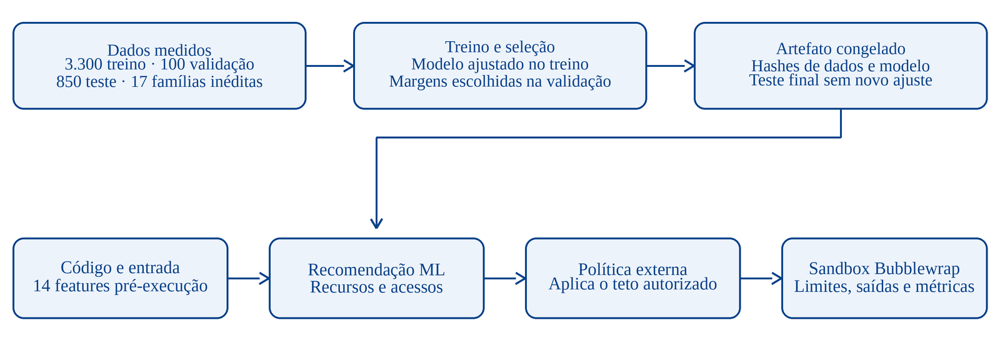

# Metodologia e protocolo experimental

## Pergunta e hipótese

Um recomendador supervisionado consegue reduzir os limites configurados e as
capacidades excedentes de uma sandbox sem reduzir as conclusões corretas em
relação a um perfil fixo e a uma heurística? Um limite menor não implica menor
uso físico de RAM nem execução mais rápida; essas grandezas são relatadas à
parte. O experimento mede workloads controlados, não pretende provar uma
superioridade universal do aprendizado de máquina.

## Escopo e isolamento

O sistema executa scripts Python/stdlib recebidos como arquivos. Não inclui um
agente gerador completo nem depende de API paga ou LLM. O usuário fornece a
entrada e o destino; o modelo não escolhe caminhos, rede ou novas permissões.

Bubblewrap monta o ambiente e as entradas com acesso somente para leitura,
isola a rede e cria os namespaces necessários. O processo recebe limites
RLIMIT_AS, RLIMIT_CPU, RLIMIT_FSIZE e RLIMIT_NOFILE, além de timeout de parede.
Sem suporte aos namespaces, a execução falha sem fallback no host. O protótipo
não implementa cgroups agregados de memória/processos, quota total de disco ou
tmpfs, nem política seccomp específica; a medição do supervisor não resiste a
código adversarial. Não está pronto para execução pública multiusuário.

## Dados e partições

Os workloads são sintéticos, determinísticos e medidos em uma máquina Linux.
Famílias inteiras ficam em uma única partição para reduzir vazamento entre
variantes parecidas.

| Partição | Famílias | Amostras | Uso |
|---|---:|---:|---|
| Treino | 67 | 3.300 | Ajuste do modelo único |
| Validação | 5 | 100 | Escolha de margens e avaliação de desenvolvimento |
| Teste final | 17 | 850 | Avaliação após o congelamento |

O teste corresponde a 20% dos 4.250 registros. Suas 17 famílias são distintas
das usadas no treino e na validação. Os registros do teste não participam do
ajuste nem da seleção de margens.

Cada tarefa tem três execuções de referência com limite de 256 MiB de espaço
virtual por processo, 5 s de parede e 3 s de CPU. O alvo é o maior VmPeak e a
maior duração observados. VmPeak é amostrado em `/proc` e pode perder picos muito
curtos; RSS também é registrado, mas não é o alvo do RLIMIT_AS. Uma espera
artificial de 40 ms mantém os dados vivos para amostragem e cria um piso
temporal. Resultados de duração têm essa limitação.

Capacidades são rótulos do contrato de cada workload: ler `/input` e escrever
em `/output`. Os programas não são código de agentes reais e os rótulos não
demonstram causalidade universal sobre programas arbitrários.

## Features e modelo

O modelo usa 14 features anteriores à execução: tamanho da entrada e do código,
medidas da AST, laços, compreensões, chamadas, imports, operações de leitura e
escrita, ordenação, JSON, hash, alocação e maior literal numérico. Os campos de
leitura/escrita reconhecem `Path.read_text()` e `Path.open()` quando o caminho
literal pertence a `/input` ou `/output`. Identificador, família, split e
medições posteriores à execução não entram no estimador.

O único artefato ativo é um modelo híbrido:

- Extra Trees Regressor com 256 árvores, folhas mínimas de quatro amostras,
  semente 336 e um worker estima VmPeak.
- Gradient Boosting Regressor com 200 estágios, profundidade 2, taxa 0,03 e
  perda Huber estima tempo.
- Extra Trees Classifier com 128 árvores e folhas mínimas de duas amostras
  classifica leitura e escrita.

Os alvos de memória e tempo são transformados com `log1p` no fit. A inferência
usa limites inferiores de 24 MiB e 200 ms, soma 4 MiB e 80 ms às estimativas e
aplica margens congeladas. A validação escolhe o menor orçamento médio
normalizado à heurística que alcance cobertura conjunta completa quando
possível; se a grade não alcançar 100%, escolhe a maior cobertura antes do
menor orçamento. As margens congeladas são 1,35 para memória e 1,20 para tempo.
Os resultados medidos na validação servem à seleção, não a uma estimativa
independente de generalização.

A política de autorização intersecta a recomendação com o teto externo. O
modelo não pode elevar esse teto; recomendações não finitas, capacidades
desconhecidas e valores fora do contrato são rejeitados.

## Baselines e comparação

Perfil fixo: 128 MiB, 2 s e ambas as capacidades. Heurística: 32 MiB mais 64
vezes os MiB da entrada, limitado a 256 MiB; 1 s mais os MiB da entrada. Ela
usa as features AST de leitura/escrita, incluindo abertura literal de arquivos
em `/input` e `/output`. CPU, tamanho de saída e sandbox são iguais nos três
métodos.

Cada tarefa recebe um replay por método em ordem determinística embaralhada.
Esse replay é distinto das três referências usadas para criar os alvos. Sucesso
operacional exige retorno zero, ausência de timeout e igualdade de stdout e
hashes das saídas.

As métricas incluem MAE de memória/tempo, F1 micro e correspondência exata de
capacidades, capacidades omitidas/excedentes, conclusões por família, limites
médios configurados e duração observada. Intervalos de Wilson são apenas
descritivos: as variantes de uma família não são amostras independentes. O
teste final não é usado para escolher features, hiperparâmetros ou margens.

## Reprodução e limites

Os JSONL registram hashes dos dados e o instante real de observação. A
configuração congelada registra os hashes de treino, validação e modelo. A
avaliação completa gera relatório local em `reports/` e não sobrescreve uma
execução anterior.

O conjunto é pequeno por família, autoral e executado em um único ambiente.
Esses resultados não substituem testes com código real, hardware diferente,
repetições independentes, revisão humana dos contratos ou auditoria do
isolamento.

## Fluxo de dados

